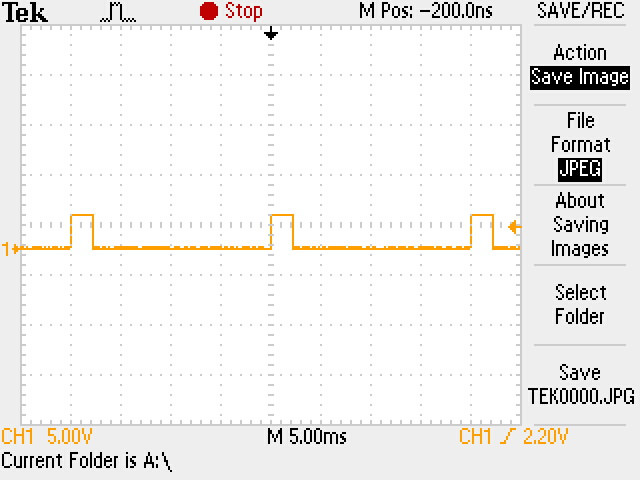
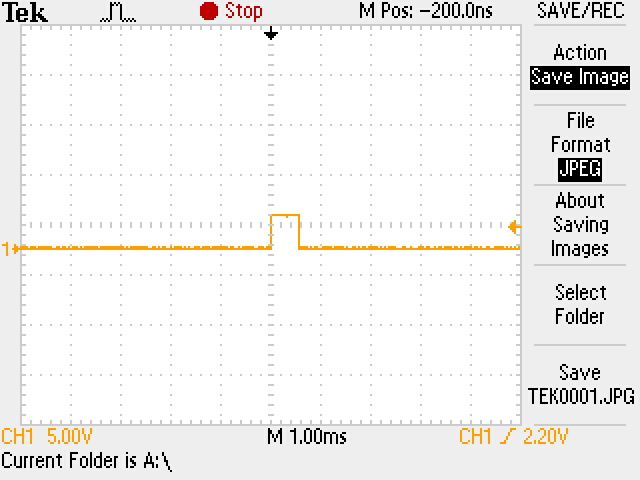
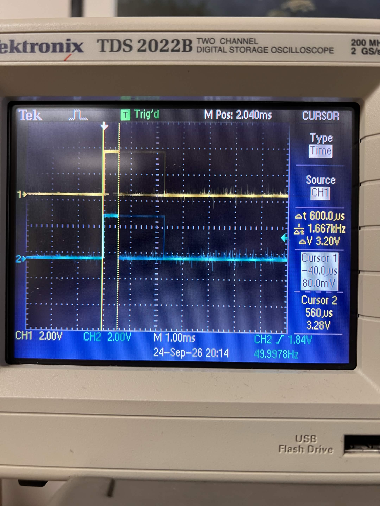
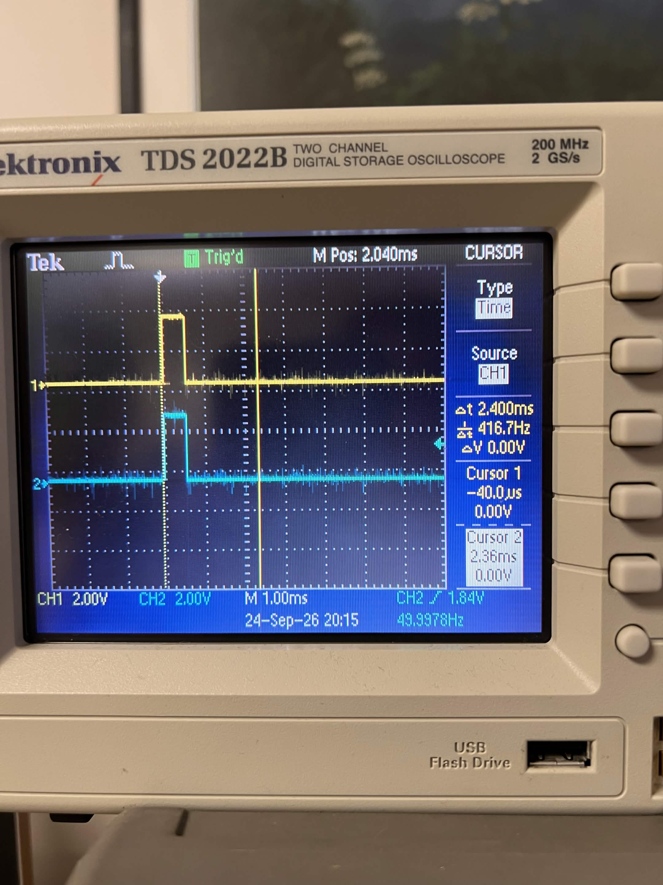
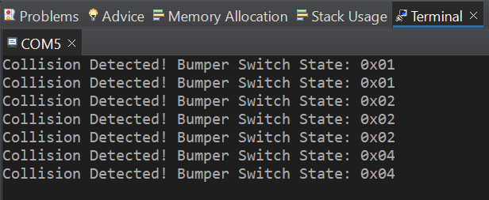
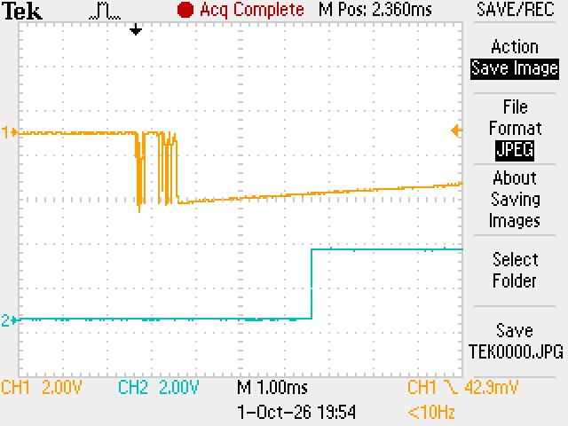

# ECE 528/L - Robotics and Embedded Systems with Lab
**CSU Northridge**

**Department of Electrical and Computer Engineering**

## Lab 1 Report: Motor Control

**Group 12**

The Motor Control lab interfaces with the following:

* User LEDs of the TI MSP432 LaunchPad
* Pololu Gearmotor with Encoder - [Product Link](https://www.pololu.com/product/3675)
* Left Bumper Switches for TI-RSLK MAX - [Product Link](https://www.pololu.com/product/3673)
* Right Bumper Switches for TI-RSLK MAX - [Product Link](https://www.pololu.com/product/3674)
* HS-485HB Servo-Stock Rotation - [Product Link](https://www.servocity.com/hs-485hb-servo/)

---

## 1. Overview

This lab uses Pulse Width Modulation (PWM) and edge-triggered interrupts on the MSP432P401R LaunchPad to drive a robot. Timer A2 generates two 50 Hz PWM signals that position two HS-485HB servos. Timer A0 generates two 50 Hz PWM signals that set the speed of the DC motors through the DRV8838 motor drivers on the chassis board. The six bumper switches on Port 4 generate falling-edge interrupts that report a collision. SysTick generates a 1 ms periodic interrupt that drives the chassis board LEDs.

In the final program, the robot drives forward at a 30% duty cycle. When a bumper switch is pressed, the robot stops, backs up, turns to the right, and then continues forward. The PWM signals and the bouncing of the bumper switches were measured with an oscilloscope.

## 2. Design Summary

### 2.1 Architecture

| Module | File | Purpose |
|--------|------|---------|
| SysTick | `SysTick_Interrupt.c` | 1 ms periodic interrupt. Drives the chassis board LEDs. |
| Timer A2 PWM | `Timer_A2_PWM.c` | 50 Hz PWM on P5.6 and P5.7 for the two servos. Provided complete. |
| Timer A0 PWM | `Timer_A0_PWM.c` | 50 Hz PWM on P2.6 and P2.7 for the two DC motors. |
| Motor | `Motor.c` | Direction, sleep, and speed control of the DRV8838 drivers. Built on Timer A0 PWM. |
| Bumper Switches | `Bumper_Switches.c` | Falling-edge interrupts on Port 4 and a user callback. |
| Application | `main.c` | Interrupt handlers, `Drive_Pattern_1()`, and `Handle_Collision()`. |

### 2.2 Pinout

| Device | Pin(s) | Direction | Notes |
|--------|--------|-----------|-------|
| Servo 1 / Servo 2 PWM | P5.6 / P5.7 | Output | PM_TA2.1 / PM_TA2.2. Servos are powered from 5 V. |
| Right / Left motor PWM (EN) | P2.6 / P2.7 | Output | PM_TA0.3 / PM_TA0.4 |
| Right / Left motor direction (PH) | P5.5 / P5.4 | Output | `0` is forward, `1` is backward |
| Right / Left motor sleep (nSLEEP) | P3.6 / P3.7 | Output | `1` enables the driver |
| Right bumper BMP0 - BMP2 | P4.0, P4.2, P4.3 | Input | Active low, internal pull-up |
| Left bumper BMP3 - BMP5 | P4.5, P4.6, P4.7 | Input | Active low, internal pull-up |
| Front yellow LEDs | P8.0, P8.5 | Output | Toggle every 500 ms while driving |
| Back red LEDs | P8.6, P8.7 | Output | On while a collision is being handled |

### 2.3 PWM Generation

Both timers use SMCLK (12 MHz), Up/Down mode (`MC = 3`), and output mode Toggle/Reset (`OUTMOD = 010b`). In Up/Down mode the period is:

```
Period = (2 * CCR[0]) / (12 MHz / prescale)
```

The output is high from the compare match on the way down to the compare match on the way up, so the pulse width is `2 * CCR[n]` timer counts and the duty cycle is `CCR[n] / CCR[0]`.

| Timer | Prescale (`ID`) | Timer clock | `CCR[0]` | Period | `CTL` value |
|-------|:---------------:|:-----------:|:--------:|:------:|:-----------:|
| Timer A2 (servos) | 2 | 6 MHz | 60000 | 20 ms | `0x0270` |
| Timer A0 (motors) | 8 | 1.5 MHz | 15000 | 20 ms | `0x02F0` |

`Timer_A0_PWM_Init()` follows the same steps as `Timer_A2_PWM_Init()`, with P2.6 and P2.7 in peripheral function mode and compare registers `CCR[3]` and `CCR[4]`:

```c
P2->SEL0 |= 0xC0;
P2->SEL1 &= ~0xC0;
P2->DIR |= 0xC0;
TIMER_A0->CCR[0] = period_constant;
TIMER_A0->EX0 = 0x0000;
TIMER_A0->CCTL[3] |= 0x0040;
TIMER_A0->CCR[3] = duty_cycle_1;
TIMER_A0->CCTL[4] |= 0x0040;
TIMER_A0->CCR[4] = duty_cycle_2;
TIMER_A0->CTL |= 0x02F0;
```

The init and update functions return without changing anything if a duty cycle value is greater than or equal to the period constant.

The duty cycle values used in this lab are:

| Timer | Compare value | Result |
|-------|:-------------:|--------|
| Timer A2 | 1700 | 2 * 1700 / 6 MHz = 567 us pulse (servo at 0 degrees) |
| Timer A2 | 7000 | 2 * 7000 / 6 MHz = 2333 us pulse (servo at 180 degrees) |
| Timer A0 | 7500 | 50% duty cycle |
| Timer A0 | 4500 | 30% duty cycle |
| Timer A0 | 1500 | 10% duty cycle |

### 2.4 Motor Driver

`Motor_Init()` configures P5.4, P5.5, P3.6, and P3.7 as GPIO outputs, clears them, and starts Timer A0 with a duty cycle of 0. Each movement function sets the two direction pins, updates the two duty cycles, and then sets P3.6 and P3.7 to wake the drivers.

| Function | Left motor (P5.4) | Right motor (P5.5) | Robot movement |
|----------|:-----------------:|:------------------:|----------------|
| `Motor_Forward()` | `0` forward | `0` forward | Forward |
| `Motor_Backward()` | `1` backward | `1` backward | Backward |
| `Motor_Left()` | `1` backward | `0` forward | Turns left in place |
| `Motor_Right()` | `0` forward | `1` backward | Turns right in place |
| `Motor_Stop()` | `0` | `0` | Drivers asleep, duty cycle 0 |

### 2.5 Bumper Switch Interrupts

The mask `0xED` selects P4.7, P4.6, P4.5, P4.3, P4.2, and P4.0. `Bumper_Switches_Init()` stores the callback and then writes the registers in this order:

| Register | Operation | Purpose |
|----------|-----------|---------|
| `P4->SEL0`, `P4->SEL1` | `&= ~0xED` | Select GPIO mode |
| `P4->DIR` | `&= ~0xED` | Set the pins as inputs |
| `P4->REN`, `P4->OUT` | `\|= 0xED` | Enable the pull-up resistors |
| `P4->IES` | `\|= 0xED` | Trigger on the falling edge |
| `P4->IFG` | `&= ~0xED` | Clear any pending flags |
| `P4->IE` | `\|= 0xED` | Enable the pin interrupts |
| `NVIC->IP[9]` | `& 0xFF0FFFFF` | Set the priority of IRQ 38 to 0 |
| `NVIC->ISER[1]` | `0x00000040` | Enable IRQ 38 (Port 4) |

`PORT4_IRQHandler()` clears the flags and calls the callback with the value from `Bumper_Read()`. `Bumper_Read()` inverts `P4->IN` and packs the six switches into bits 5 - 0, so BMP0 is `0x01` and BMP5 is `0x20`.

The Port 4 interrupt has priority 0 and the SysTick interrupt has priority 2, so a collision is recorded even while `SysTick_Handler()` is running.

### 2.6 Application

The global flag `collision_detected` is shared by three contexts: `Bumper_Switches_Handler()`, `SysTick_Handler()`, and `main()`.

The flag is the software answer to switch bouncing. The first falling edge sets it, and later edges from the same press are ignored because the handler does nothing while the flag is set. `Handle_Collision()` clears the flag only at the end of its sequence.

`Drive_Pattern_1()` was used to test the motor driver. It runs forward at 50%, left at 30%, right at 30%, and backward at 30%, each for 2 s with a 2 s stop after each movement.

## 3. Verification and Results


### 3.1 Servo PWM (Timer A2)

The main loop alternated between compare values of 1700 (RGB LED red) and 7000 (RGB LED blue) every 3 s, with CH1 on P5.6 and CH2 on P5.7.

| Measurement | Expected | Measured |
|-------------|:--------:|:--------:|
| PWM frequency | 50 Hz | 49.9978 Hz |
| Pulse width at 0 degrees | 567 us (540 - 580 us) | Falling edge at 560 us after the trigger, cursor delta 600 us |
| Pulse width at 180 degrees | 2333 us (2320 - 2360 us) | Falling edge at 2.36 ms after the trigger, cursor delta 2.400 ms |
| High level | 3.3 V | 3.28 V |

The scope was triggered on the rising edge of the pulse, so the position of cursor 2 on the falling edge is the pulse width. Cursor 1 was left one cursor step (40 us) before the rising edge, which is why the delta readouts are 40 us larger than the pulse widths. Both channels show the same pulse, as expected for equal compare values.

**PWM period at 5 ms/div: one pulse every 20 ms**



**Pulse at 0 degrees, 1 ms/div**



**Pulse width at 0 degrees (compare value 1700)**



**Pulse width at 180 degrees (compare value 7000)**



### 3.2 Bumper Switch Interrupts

For this test, `Bumper_Switches_Handler()` printed the switch state and set P8.7 high on every interrupt, without the `collision_detected` check. The serial terminal (115200 baud, 8 data bits, no parity, 1 stop bit) shows the output for presses of BMP0, BMP1, and BMP2:



The values `0x01`, `0x02`, and `0x04` match the bit positions returned by `Bumper_Read()`. Each press printed two or three messages, which shows that one press generated more than one falling-edge interrupt.

### 3.3 Switch Bouncing

CH1 was connected to P4.0 (BMP0) and CH2 to P8.7, with a single-sweep falling-edge trigger on CH1.



| Observation | Value |
|-------------|-------|
| Bounce duration on BMP0 | About 1 ms, with several falling edges |
| Delay from the first falling edge to P8.7 high | About 4 ms |

The bounce explains the repeated messages in Section 3.2. The 4 ms delay is consistent with the handler calling `printf` before it writes to P8.7: the message is 46 characters, which takes about 4 ms to send at 115200 baud.

### 3.4 Motor Driver and Collision Handling

| Test | Main loop | Expected behavior |
|------|-----------|-------------------|
| Motor driver | `Drive_Pattern_1()` | Forward, left turn, right turn, and backward, 2 s each with 2 s stops |
| Collision handling | `Handle_Collision()` or `Motor_Forward(4500, 4500)` | Drives forward with the front yellow LEDs blinking. On a bumper press, the back red LEDs turn on and the robot runs the sequence in Section 2.6, then drives forward again. |


## 4. Known Issues or Limitations

* **No debounce filter.** Bouncing is masked by the `collision_detected` flag, not removed. The Port 4 interrupt still fires on every bounce.
* **The collision response does not use the switch state.** The robot always turns right, even when the right bumper was hit.
* **The motors run open loop.** The encoders are not used, so the robot may drift when both motors are given the same duty cycle.

## 5. References

1. ECE 528/L Lab 1: Motor Control, Aaron Nanas, Fall 2026 (`ece528L_fall26_lab1_motor_control.pdf`)
2. [MSP432P401R SimpleLink Microcontroller LaunchPad Development Kit User's Guide](https://docs.rs-online.com/3934/A700000006811369.pdf)
3. MSP432P401R Datasheet
4. Robot Systems Learning Kit (TI-RSLK) User Guide
5. MSP432P4xx SimpleLink Microcontrollers Technical Reference Manual (SLAU356I): SysTick (2.4.4), NVIC (2.2.2), Timer_A (19)
6. [Left Bumper Switches for TI-RSLK MAX](https://www.pololu.com/product/3673)
7. [Right Bumper Switches for TI-RSLK MAX](https://www.pololu.com/product/3674)
8. TI DRV883x Motor Driver Datasheet
9. [HS-485HB Servo-Stock Rotation](https://www.servocity.com/hs-485hb-servo/)
